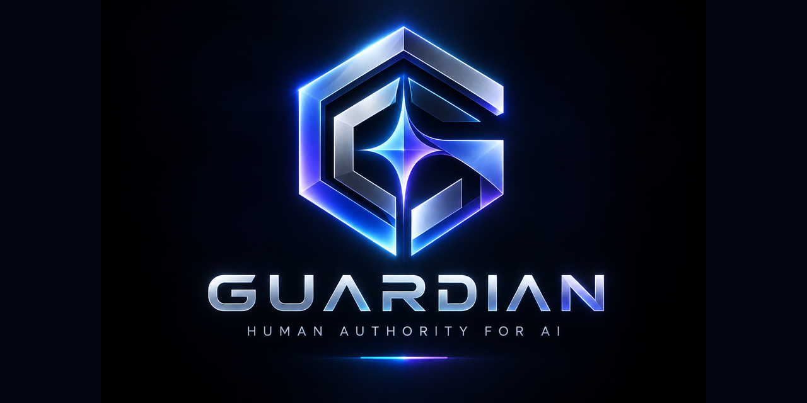

<p align="center">
  
</p>

# Guardian SDK

[](https://www.npmjs.com/package/@odingard/guardian-sdk)
[](https://registry.modelcontextprotocol.io/)
[](https://mcprush.com/to/odingard-guardian-mcp?ref=badge)
[](LICENSE)

**Guardian is the trust layer for agent commerce.** Human Authority Infrastructure for Autonomous AI: the agent proposes; the human decides.

Every tool call an agent makes gets a deterministic
`ALLOW` / `ASK` / `DENY` decision before it runs, and every execution produces a
signed, tamper-evident decision record you can verify without an account. The record format is an open specification: [`greceipt.v1`](docs/spec/greceipt-v1.md).

Hosted Guardian: [guardian.odingard.com](https://guardian.odingard.com) — free
tier, no card required. [Pricing](https://odingard.com/guardian#gd-pricing): Free, Developer $99/month with 25,000 billable executions included, Enterprise: talk to us.

## Set up with your coding agent

Open Claude Code, Codex or another coding agent in your project folder and paste:

```text
Set up Guardian using https://odingard.com/guardian/skill.md
```

The agent reads [`skill.md`](skill.md): it checks your project read-only, shows
you its plan and waits for a yes, sends you to the console to create the agent
and its credential (you keep the credential out of the chat), installs pinned
package versions, and runs one test that waits for your approval. It cannot
create the account, the agent or the credential for you. Versions are listed in
[`docs/skill-changelog.md`](docs/skill-changelog.md) with the SHA-256 of each file.

## Packages

| Package                                                                                              | Use it when                                                                                                                                                                                                                                                            | Docs                                             |
| ---------------------------------------------------------------------------------------------------- | ---------------------------------------------------------------------------------------------------------------------------------------------------------------------------------------------------------------------------------------------------------------------- | ------------------------------------------------ |
| [`@odingard/guardian`](packages/guardian)                                                            | Not on npm yet; build and run it from this repository (see its README). `guardian init` sets Guardian up for an agent project in one command: it signs you in, creates the agent and its tool server, saves the credential and sends a test action                     | [packages/guardian](packages/guardian)           |
| [`@odingard/guardian-sdk`](https://www.npmjs.com/package/@odingard/guardian-sdk)                     | You call Guardian from your own agent code: `createGuard` for your own action code, plus the core client, signed decision records and approvals                                                                                                                        | [packages/sdk](packages/sdk)                     |
| [`odingard-guardian`](packages/python) (PyPI)                                                        | You build in Python, sync or async: `Guard` for your own action code, integrations for LangChain / LangGraph, the OpenAI Agents SDK, Microsoft Agent Framework, Semantic Kernel and Hermes Agent                                                                       | [packages/python](packages/python)               |
| [`@odingard/guardian-mcp`](https://www.npmjs.com/package/@odingard/guardian-mcp)                     | Your agent speaks MCP (Claude, Cursor, …), with no code needed. `guardian-mcp proxy` governs an existing MCP server, local (stdio) or remote (`--url`)                                                                                                                 | [packages/mcp](packages/mcp)                     |
| [`@odingard/guardian-langchain`](https://www.npmjs.com/package/@odingard/guardian-langchain)         | You build with LangChain.js / LangGraph                                                                                                                                                                                                                                | [packages/langchain](packages/langchain)         |
| [`@odingard/guardian-vercel-ai`](https://www.npmjs.com/package/@odingard/guardian-vercel-ai)         | You build with the Vercel AI SDK                                                                                                                                                                                                                                       | [packages/vercel-ai](packages/vercel-ai)         |
| [`@odingard/guardian-hook`](https://www.npmjs.com/package/@odingard/guardian-hook)                   | Your coding agent runs shell commands and edits files (Claude Code, Claude Agent SDK, Codex CLI, DeepSeek Harness)                                                                                                                                                     | [packages/hook](packages/hook)                   |
| [`@odingard/guardian-openai-agents`](https://www.npmjs.com/package/@odingard/guardian-openai-agents) | You build with the OpenAI Agents SDK (TypeScript): every tool you wrap with `guardianTool` is decided by Guardian before it runs                                                                                                                                       | [packages/openai-agents](packages/openai-agents) |
| [`@odingard/guardian-mastra`](packages/mastra) (unreleased, not on npm yet) | You build with Mastra (TypeScript): every tool you wrap with `guardianTool` is decided by Guardian before it runs | [packages/mastra](packages/mastra) |
| [`@odingard/guardian-openclaw`](https://www.npmjs.com/package/@odingard/guardian-openclaw)           | You run an OpenClaw agent: a native plugin governs exec, file edits, messages and MCP tools                                                                                                                                                                            | [packages/openclaw](packages/openclaw)           |
| [`@odingard/guardian-x402`](https://www.npmjs.com/package/@odingard/guardian-x402)                   | Your agent pays over x402: Guardian decides payments made through the guarded official x402 TypeScript clients, before the wallet signs. Supports USDC on Base Sepolia (testnet). Base mainnet is off by default; run your flow on Base Sepolia before you turn it on. | [packages/x402](packages/x402)                   |
| [`@odingard/guardian-ap2`](https://www.npmjs.com/package/@odingard/guardian-ap2)                     | Your agent pays over AP2 v0.2: Guardian decides closed Checkout and Payment Mandates before the agent key signs them (pinned merchant keys, USD)                                                                                                                       | [packages/ap2](packages/ap2)                     |

## Quickstart

```bash
npm install @odingard/guardian-sdk
```

```ts
import {
  classifyRequestResult,
  createGuardianClient,
} from "@odingard/guardian-sdk";

const guardian = createGuardianClient({
  baseUrl: "https://guardian-api.odingard.com",
  credential: process.env.GUARDIAN_AGENT_CREDENTIAL!, // gak_… issued per agent
});

const d = classifyRequestResult(
  await guardian.request({
    action: "tool.invoke",
    connectionId: "pcn_…",
    toolName: "refund_order",
    arguments: { orderId: "ord_123" },
  }),
);

if (d.decision === "ALLOW") {
  await guardian.execute({
    requestId: d.requestId,
    capabilityToken: d.capabilityToken,
  });
}
// ASK → held for a human (keep d.requestId, then guardian.claim). DENY → never runs.
```

More in [docs/guides.md](docs/guides.md): `createGuard` for your own action
code, file arguments (`fileArgs`), dollar amounts (`amountArgs`), an MCP server
you already use, and Hermes Agent.

## Works with

Any agent can use Guardian by one of three routes: put its MCP servers behind
the **MCP proxy** (`guardian-mcp proxy`), add the **coding-agent hook**
(`guardian-hook`), or call the **SDK / HTTP API** in front of any action
(`createGuard`, Python `@guard`). The table lists the integrations we ship or
document.

| Integration                                     | Package                                                           |
| ----------------------------------------------- | ----------------------------------------------------------------- |
| Claude Code                                     | `@odingard/guardian-hook`                                         |
| Claude Agent SDK (TypeScript)                   | `@odingard/guardian-hook`                                         |
| Any MCP server, local (stdio)                   | `@odingard/guardian-mcp`                                          |
| Any MCP server, remote (`--url`)                | `@odingard/guardian-mcp`                                          |
| LangChain.js / LangGraph                        | `@odingard/guardian-langchain`                                    |
| Vercel AI SDK                                   | `@odingard/guardian-vercel-ai`                                    |
| OpenAI Agents SDK (TypeScript)                  | `@odingard/guardian-openai-agents`                                |
| Mastra (TypeScript)                             | `@odingard/guardian-mastra` (unreleased)                          |
| OpenAI Agents SDK (Python)                      | `odingard-guardian[openai-agents]`                                |
| LangChain / LangGraph (Python)                  | `odingard-guardian[langchain]`                                    |
| Microsoft Agent Framework (Python)              | `odingard-guardian`                                               |
| Semantic Kernel (Python)                        | `odingard-guardian`                                               |
| Codex CLI                                       | `@odingard/guardian-hook`                                         |
| DeepSeek Harness                                | `@odingard/guardian-hook`                                         |
| Hermes Agent                                    | `odingard-guardian`                                               |
| ZeroClaw                                        | `@odingard/guardian-mcp` ([recipe](examples/agents/zeroclaw))     |
| Your own container (CrewAI, LangGraph, AutoGen) | `@odingard/guardian-mcp` ([recipe](examples/mcp/byo))             |
| OpenClaw                                        | `@odingard/guardian-openclaw`                                     |
| NVIDIA NemoClaw (guide)                         | `@odingard/guardian-openclaw` ([guide](examples/agents/nemoclaw)) |
| x402 payments (TypeScript)                      | `@odingard/guardian-x402`                                         |
| AP2 mandates (TypeScript)                       | `@odingard/guardian-ap2`                                          |

In NemoClaw the OpenClaw plugin runs in its opt-out mode, in which the agent
can switch Guardian off (see the [guide](examples/agents/nemoclaw)).

## Docs and examples

- Package READMEs: [packages/sdk](packages/sdk/README.md) ·
  [packages/python](packages/python/README.md) ·
  [packages/mcp](packages/mcp/README.md) · [packages/hook](packages/hook/README.md) ·
  every package in the [table above](#packages).
- Guides: [docs/guides.md](docs/guides.md).
- Record format: [`greceipt.v1`](docs/spec/greceipt-v1.md).
- Runnable demos, grouped by topic: [examples/](examples/README.md).

## Repository layout

```text
packages/sdk            @odingard/guardian-sdk            core client
packages/mcp            @odingard/guardian-mcp            MCP server
packages/hook           @odingard/guardian-hook           coding-agent hooks
packages/langchain      @odingard/guardian-langchain
packages/vercel-ai      @odingard/guardian-vercel-ai
packages/openai-agents  @odingard/guardian-openai-agents  OpenAI Agents SDK adapter
packages/mastra         @odingard/guardian-mastra         Mastra adapter (unreleased)
packages/steel          @odingard/guardian-steel
packages/openclaw       @odingard/guardian-openclaw       OpenClaw plugin
packages/x402           @odingard/guardian-x402           x402 payment guard
packages/ap2            @odingard/guardian-ap2            AP2 mandate guard
packages/python         odingard-guardian (PyPI)          Python SDK
examples/               runnable demos, grouped by topic (index: examples/README.md)
docs/                   guides, greceipt.v1 spec, skill.md changelog
scripts/                repository checks (skill.md against the packages)
skill.md                setup file for coding agents
assets/                 logos
```

`packages/sdk/src/contracts`, `packages/sdk/src/evidence`, the SDK client,
guard, lifecycle and `receipts.ts` sources, and the Steel adapter sources are generated
— don't edit them here. See [CONTRIBUTING.md](CONTRIBUTING.md).

## License

Apache-2.0
