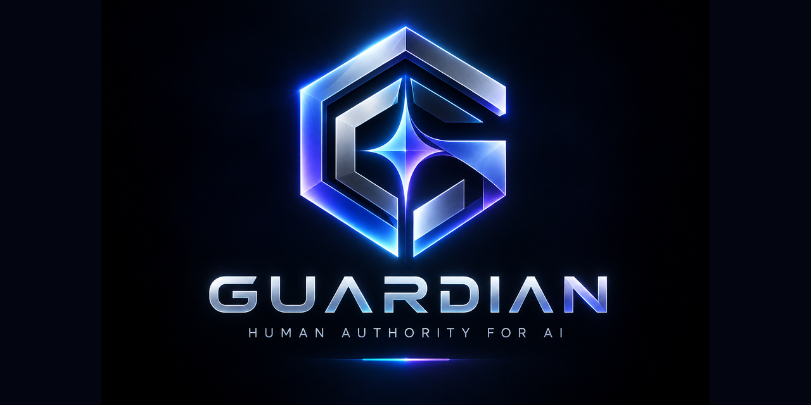

<p align="center">
  
</p>

# Guardian SDK

[](https://www.npmjs.com/package/@odingard/guardian-sdk)
[](https://registry.modelcontextprotocol.io/)
[](https://mcprush.com/to/odingard-guardian-mcp?ref=badge)
[](LICENSE)

**Human Authority Infrastructure for Autonomous AI.** The agent proposes; the
human decides. Every tool call an agent makes gets a deterministic
`ALLOW` / `ASK` / `DENY` decision before it runs, and every execution produces a
tamper-evident receipt you can verify without an account. The receipt format is an open specification: [`greceipt.v1`](docs/spec/greceipt-v1.md).

Hosted Guardian: [guardian.odingard.com](https://guardian.odingard.com) — free
tier, no card required. [Pricing](https://odingard.com/guardian#gd-pricing): Free, Developer $99/month with 25,000 billable executions included, Business via sales.

## Packages

| Package                                                                                      | Use it when                                                                                                                           | Docs                                     |
| -------------------------------------------------------------------------------------------- | ------------------------------------------------------------------------------------------------------------------------------------- | ---------------------------------------- |
| [`@odingard/guardian-sdk`](https://www.npmjs.com/package/@odingard/guardian-sdk)             | You call Guardian from your own agent code: `createGuard` for your own action code, plus the core client, receipts and approvals      | [packages/sdk](packages/sdk)             |
| [`odingard-guardian`](packages/python) (PyPI)                                                | You build in Python (LangChain, CrewAI, OpenAI Agents, Claude Agent SDK, plain code), sync or async                                   | [packages/python](packages/python)       |
| [`@odingard/guardian-mcp`](https://www.npmjs.com/package/@odingard/guardian-mcp)             | Your agent speaks MCP (Claude, Cursor, …), with no code needed. `guardian-mcp proxy` governs any existing MCP server, local or remote | [packages/mcp](packages/mcp)             |
| [`@odingard/guardian-langchain`](https://www.npmjs.com/package/@odingard/guardian-langchain) | You build with LangChain.js / LangGraph                                                                                               | [packages/langchain](packages/langchain) |
| [`@odingard/guardian-vercel-ai`](https://www.npmjs.com/package/@odingard/guardian-vercel-ai) | You build with the Vercel AI SDK                                                                                                      | [packages/vercel-ai](packages/vercel-ai) |
| [`@odingard/guardian-steel`](https://www.npmjs.com/package/@odingard/guardian-steel)         | Your browser agent checks out on Steel                                                                                                | [packages/steel](packages/steel)         |
| `@odingard/guardian-openclaw` (not yet published)                                            | You run an OpenClaw agent: a native plugin governs exec, file edits, messages and MCP tools. Not yet proven live                      | [packages/openclaw](packages/openclaw)   |

## Quickstart

```bash
npm install @odingard/guardian-sdk
```

```ts
import {
  classifyRequestResult,
  createGuardianClient,
} from "@odingard/guardian-sdk";

const guardian = createGuardianClient({
  baseUrl: "https://guardian-api.odingard.com",
  credential: process.env.GUARDIAN_AGENT_CREDENTIAL!, // gak_… issued per agent
});

const d = classifyRequestResult(
  await guardian.request({
    action: "tool.invoke",
    connectionId: "con_…",
    toolName: "refund_order",
    arguments: { orderId: "ord_123" },
  }),
);

if (d.decision === "ALLOW") {
  await guardian.execute({
    requestId: d.requestId,
    capabilityToken: d.capabilityToken,
  });
}
// ASK → held for a human (keep d.requestId, then guardian.claim). DENY → never runs.
```

### Govern your own action code (any framework)

```ts
import { createGuard } from "@odingard/guardian-sdk";

const guard = createGuard({ client: guardian, connectionId: "con_…" });
const payInvoice = guard("pay_invoice", async (inv) =>
  myPaymentProvider.pay(inv),
); // your code
await payInvoice({
  invoiceId: "INV-1002",
  amountCents: 1_240_000,
  payeeId: "acme",
});
// ALLOW → your code runs + receipt. ASK → GuardianApprovalPending (resume() after approval). DENY → never runs.
```

```python
from odingard_guardian import Guard, GuardianClient

guard = Guard(GuardianClient(credential=...), connection_id="con_…")

@guard("pay_invoice")
def pay_invoice(invoice_id: str, amount_cents: int, payee_id: str): ...  # your code
```

### Govern an MCP server you already use

```bash
guardian-mcp proxy -- npx -y your-whatsapp-mcp-server
```

### Govern Hermes Agent (Nous Research)

```bash
pip install odingard-guardian   # in Hermes' Python; ships the Hermes plugin "guardian"
hermes plugins enable guardian  # plus plugins.hook_callback_timeout: 130 in config.yaml
```

Hermes calls the plugin before every tool call (terminal, file edits,
`execute_code`, the browser, MCP tools, …). Guardian decides; a block holds.
Read-only tools are not routed, and anything outside Hermes' tool dispatch is
not governed. Not yet proven live. See [examples/hermes](examples/hermes/README.md).

Full guides: [packages/sdk](packages/sdk/README.md) ·
[packages/python](packages/python/README.md) · [packages/mcp](packages/mcp/README.md).

## Examples

Runnable demos in [`examples/`](examples/) — each prints `SIMULATED` (local
demo policy) or `LIVE` (real hosted Guardian or real published keys).

```bash
npm install && npm run build
cd examples
node verify-receipt.mjs         # LIVE, no account: verify a real receipt offline, then tamper
node demo-classes.mjs           # the 7 demo classes
node steel-checkout.mjs         # Steel checkout → ASK → resume
node shopping-agent.mjs         # purchase → ASK, human approves, receipt
node prompt-injection-deny.mjs  # injected "export contacts" → DENY
node coding-agent-ask.mjs       # consequential command → ASK
node invoice-agent.mjs          # B2B invoices: ALLOW under $5k, ASK above, DENY unknown payee (createGuard)
python python/invoice_agent.py  # the same, in Python (pip install odingard-guardian)
node remote-mcp.mjs             # guardian-mcp in front of a remote (HTTP) MCP server; SIMULATED fail-closed, LIVE with Guardian env (not yet proven live; needs this repo's unreleased guardian-mcp)
node agent-hooks.mjs codex       # Codex CLI hook: shell, apply_patch, MCP → ALLOW / ASK / DENY (guardian-hook codex)
node agent-hooks.mjs dsh         # DeepSeek Harness hook via its Claude Code bridge (guardian-hook dsh)
python hermes/hermes_hook_demo.py  # Hermes Agent's pre_tool_call hook: ALLOW / ASK / DENY (SIMULATED unless env set)
(cd openclaw && npm install && npm run simulated)  # OpenClaw plugin in OpenClaw's real hook runtime (SIMULATED Guardian)
```

Recipes (LIVE, not yet proven live): [ZeroClaw](examples/zeroclaw/README.md) ·
[your own container: CrewAI, LangGraph, AutoGen](examples/byo/README.md).

## Repository layout

```text
packages/sdk        @odingard/guardian-sdk      core client
packages/mcp        @odingard/guardian-mcp      MCP server
packages/langchain  @odingard/guardian-langchain
packages/vercel-ai  @odingard/guardian-vercel-ai
packages/steel      @odingard/guardian-steel
packages/openclaw   @odingard/guardian-openclaw OpenClaw plugin
packages/python     odingard-guardian (PyPI)    Python SDK
examples/           runnable demos
```

`packages/sdk/src/contracts`, `packages/sdk/src/evidence`, the SDK client,
guard, lifecycle and receipts sources, and the Steel adapter sources are generated
— don't edit them here. See [CONTRIBUTING.md](CONTRIBUTING.md).

## License

Apache-2.0
